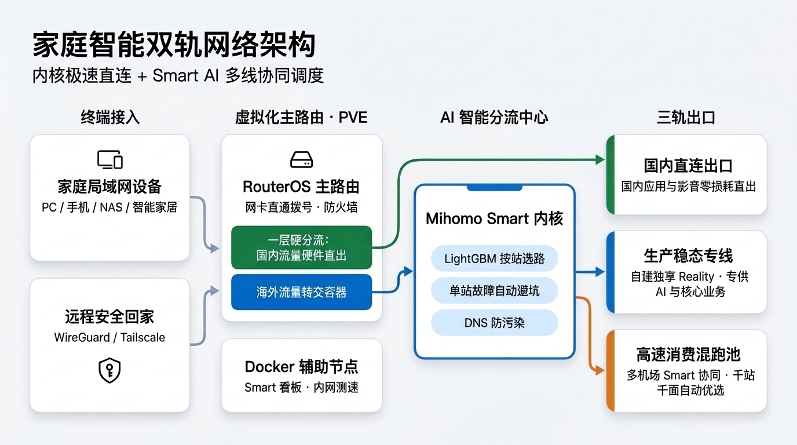

<div align="center">


<br />

[](LICENSE)
[](#3-步极速接入)
[](#技能目录)
[](CONTRIBUTING.md)

<p>
  <strong>一套经过真实家庭实验室与工程环境长期打磨的 AI Agent 实战技能库。</strong><br />
  不再复制粘贴零散教程——把 <code>SKILL.md</code> 与脱敏模板交给 AI，一键复刻高可用架构。
</p>

<p>
  <a href="#技能目录">技能目录</a> ·
  <a href="#架构实景">架构实景</a> ·
  <a href="#3-步极速接入">3 步极速接入</a> ·
  <a href="#设计理念">设计理念</a> ·
  <a href="#仓库结构">仓库结构</a>
</p>

</div>

---

## 技能目录

所有技能均遵循标准 `SKILL.md` 规范，自带防踩坑门禁、原子校验流程与全量脱敏模板：

| 技能名称 | 领域分类 | 核心能力与解决痛点 | 适用环境 | 状态 |
| :--- | :--- | :--- | :--- | :---: |
| [`ros-mihomo-smart-architect`](skills/ros-mihomo-smart-architect/SKILL.md) | 软路由 / 网络架构 | 在全新 RouterOS 7.x 上一键部署 **CNIP 内核 FastTrack 直出 + Mihomo Smart (LightGBM) 多机场混跑容器 + 防断网原子切流 + 收口 NAT** | RouterOS 7.12+ (x86 / CHR / ARM64) | **已发布** |

> 本仓库持续更新，后续实战打磨成熟的新技能将陆续开源。如果项目帮您省下了折腾时间，欢迎点一颗 **Star** 关注更新。

---

## 架构实景

以首发旗舰技能 **`ros-mihomo-smart-architect`** 为例，AI 自动交付的「内核极速直出 + Smart AI 多线协同」双轨架构全景如下：

<div align="center">
  
</div>

<br />

**这套架构为什么能做到“调完即养老”？**
- **L1 硬件级国内卸载**：RouterOS 每周自动更新大陆 `CNIP` 列表（带防空文件字节校验），命中流量在 Mangle 层直接放行并走 `FastTrack-CNIP-Direct` 硬件卸载，国内 4K 与大文件下载几乎 **0 CPU 占用**、不进代理容器。
- **L2 Smart AI 按站选路**：Mihomo Smart 内核加载 LightGBM 模型，为每个网站独立评估最优专线，自动把多家机场优势混跑叠加；遇到单站抽风时精准定向绕开，不误伤整条好节点。
- **双轨出口解耦**：AI 编程与核心业务可独立走自建稳态专线（零风控固定出口），日常大流量影音与海外站点交由多机场 Smart 池自动负载均衡。

---

## 3 步极速接入

### 1. 克隆仓库到您的 Agent 技能目录

根据您使用的 AI 编程/运维助手，任选一条命令安装：

```bash
# Antigravity (Gemini)
git clone https://github.com/wlaosj/easy-skills.git /tmp/easy-skills \
  && mkdir -p ~/.gemini/config/skills \
  && cp -R /tmp/easy-skills/skills/* ~/.gemini/config/skills/ \
  && rm -rf /tmp/easy-skills

# Claude Code
git clone https://github.com/wlaosj/easy-skills.git /tmp/easy-skills \
  && mkdir -p ~/.claude/skills \
  && cp -R /tmp/easy-skills/skills/* ~/.claude/skills/ \
  && rm -rf /tmp/easy-skills

# Cursor (项目级或全局技能目录)
git clone https://github.com/wlaosj/easy-skills.git /tmp/easy-skills \
  && mkdir -p ~/.cursor/skills \
  && cp -R /tmp/easy-skills/skills/* ~/.cursor/skills/ \
  && rm -rf /tmp/easy-skills
```

### 2. 准备好前置环境（以 ROS 部署为例）
- 一台已接通外网、开启 SSH 的 **RouterOS 7.x**（已安装 `container` 包并开启容器权限）；
- 准备好您的机场订阅链接（及可选的自建 VPS 节点信息）。

### 3. 直接在对话中唤醒 AI 执行

```text
请加载 ros-mihomo-smart-architect 技能，帮我在这台全新的 RouterOS 上部署双层分流架构：
- RouterOS 地址：192.168.x.x，账号 admin，密码 xxxxxx
- WAN 口：pppoe-out1，LAN 网段：192.168.x.0/24
- 机场订阅链接：https://...
请严格按防断网顺序先备份、先验证容器健康后再切流，完成后给我端到端验收结果。
```

---

## 设计理念

- **拒绝“玩具提示词”**：每一个 Skill 都源于真实 7×24 运行的生产/家庭环境，把踩过的坑（如 bbolt 跨页截断、NAT 误劫持、`LocationDKS` 规则截胡、CNIP 空文件清空列表、先切路由导致断网死锁）全部固化进校验门禁。
- **先备后改，安全兜底**：强制要求 Agent 在动手前先留存完整配置快照，并遵循“先起服务、先测通路、最后切流”的原子顺序。
- **100% 脱敏开源**：仓库内不含任何私有 IP、密钥、订阅链接与个人域名，全部通过显式占位符注入。

---

## 仓库结构

```text
easy-skills/
├── README.md                                     # 项目总览与快速上手指南
├── CONTRIBUTING.md                               # 技能编写规范与隐私脱敏红线
├── LICENSE                                       # MIT 开源许可证
├── assets/
│   ├── banner.svg                                # 顶部极简矢量横幅
│   └── ros-mihomo-smart-arch.jpg                 # 双轨分流架构示意图
└── skills/
    └── ros-mihomo-smart-architect/
        ├── SKILL.md                              # AI Agent 标准化执行手册
        └── templates/
            ├── mihomo-smart-config.yaml          # Mihomo Smart 脱敏配置模板
            └── ros-init.rsc                      # RouterOS 7.x 初始化脚本模板
```

---

<div align="center">
  <sub>Made with care by <a href="https://github.com/wlaosj">wlaosj</a> · Part of the <strong>Easy</strong> Series · Licensed under <a href="LICENSE">MIT</a></sub>
</div>
