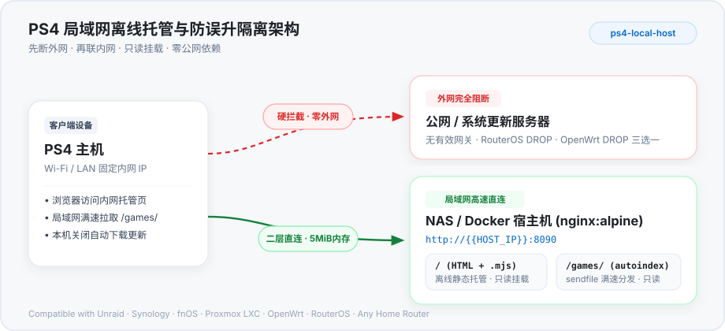

# ps4-local-host

> **一句话让 AI 搭起 PS4 局域网离线托管与防误升隔离环境 —— 不限路由器型号、不依赖公网、只读挂载、5 MiB 极轻常驻。**

提炼自真实家庭 NAS 7×24 长期运行方案，专为需要**防误连外网自动升级**与**局域网离线本地托管 + 高速游戏库分发**的 PS4 玩家打造。支持 Unraid、群晖、飞牛、PVE LXC 及任意 Linux Docker 宿主机。

---

## 架构总览

<div align="center">
  
</div>

<br />

### 核心特色
- **绝对防误升门禁**：内置「先断外网、再联 PS4」强制顺序，自动拦截 Wi-Fi / LAN 双网卡外网流量，物理杜绝后台静默升级。
- **不绑死软路由，任意路由器通用**：
  - **通用零门槛模式**：普通家用路由器（小米 / 华硕 / TP-Link 等）通过 PS4 无有效网关手动配网或路由器禁网开关即可物理断外网；
  - **RouterOS 7.x / OpenWrt 全自动模式**：内置全量脱敏脚本模板，AI 通过 SSH 一键下发静态租约与防火墙 `DROP` 规则。
- **专治加载白屏**：`nginx.conf` 显式声明 `application/javascript` 对 `.mjs` 的映射与跨域头，彻底告别模块加载失败。
- **局域网高速游戏库分发**：可选只读挂载 NAS 游戏目录至 `/games/`，开启 `autoindex` + `sendfile`，内网满速推送安装包。
- **纯净合规**：仓库仅包含纯基础设施配置与脱敏模板，不含任何第三方受版权保护的二进制文件或游戏资产。

---

## 一句话部署

无需手动折腾配置 —— 复制以下内容、按需填入您的环境信息发给支持终端的 AI（Antigravity / Claude Code / Cursor / Codex / OpenClaw 通用）：

```text
请拉取 https://github.com/wlaosj/easy-skills 中的 skills/ps4-local-host 技能，
完整阅读 SKILL.md 与 templates/ 模板，严格按“先隔离外网、再部署托管”的顺序帮我完成配置：

- Docker 宿主机 IP：192.168.x.x（Unraid / 群晖 / Linux）
- 托管端口：8090
- 静态页面目录：/path/to/ps4-host/src
- 本地游戏库目录（可选）：/path/to/ps4_games
- 路由器类型：普通家用路由器（或 RouterOS / OpenWrt，若是请提示我提供 PS4 MAC）

完成后请自动验收首页 200 OK、.mjs MIME 类型与 /games/ 索引，并把 PS4 侧的设置步骤发给我。
```

---

## 目录内容

- [`SKILL.md`](SKILL.md) — AI 标准化执行手册（含防误升门禁与端到端验收）
- [`templates/nginx.conf`](templates/nginx.conf) — 内置 `.mjs` MIME 与 `/games/` 高速索引的 Nginx 配置
- [`templates/docker-compose.yml`](templates/docker-compose.yml) — 全只读挂载的 `nginx:alpine` 容器编排模板
- [`templates/ros-ps4-isolate.rsc`](templates/ros-ps4-isolate.rsc) — RouterOS 7.x 静态租约 + WAN 硬拦截脚本模板
- [`templates/openwrt-ps4-isolate.sh`](templates/openwrt-ps4-isolate.sh) — OpenWrt UCI 防火墙硬拦截脚本模板
- [`assets/ps4-local-host-arch.svg`](assets/ps4-local-host-arch.svg) — 架构示意图

---

[← 返回 Easy Skills 总目录](../../README.md)
