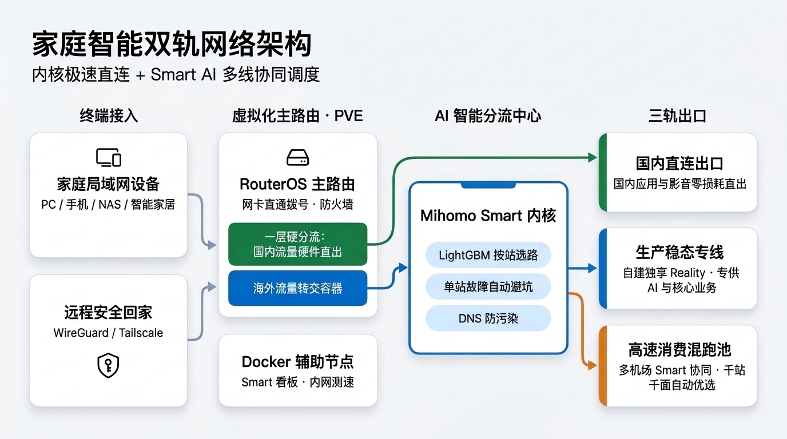

# ros-mihomo-smart-architect

> **一台全新 RouterOS 7.x + 一句话 = 全自动双层智能分流网关。**

本技能把「**CNIP 内核硬件直出 + Mihomo Smart (LightGBM) 多机场混跑 + 防断网原子校验**」整套成熟架构封装成标准 AI 手册（[`SKILL.md`](SKILL.md)）与脱敏模板（[`templates/`](templates/)），让 AI 替你一步到位完成部署。

---

## 架构全景

<div align="center">
  
</div>

<br />

- **国内流量零损耗直出（L1）**：RouterOS 每周自动更新大陆 `CNIP` 列表（带防空文件校验），命中后在 Mangle 层直接放行并走 `FastTrack-CNIP-Direct` 硬件卸载，国内大流量几乎 **0 CPU 占用**、不进代理容器。
- **海外流量 AI 按站优选（L2）**：Mihomo Smart 加载 LightGBM 模型，为每个网站独立选出最快专线，多家机场自动混跑叠加；单站抽风时精准定向避坑，不误伤整条好节点。
- **双轨出口解耦**：AI 编程与核心业务可独立指派稳态自建专线，高吞吐影音与日常网站交由多机场 Smart 池自动分担。

---

## 实测基线（脱敏真实环境）

i3 低功耗 PVE + RouterOS CHR（4C4G）+ 3 家服务商混跑实测数据：

| 累计护航请求 | 综合畅通率 | 多线协同峰值 | Mihomo 容器内存 |
| :---: | :---: | :---: | :---: |
| **450,000+ 次** | **98.2%** | **73.9 MB/s** | **~210 MiB** |

---

## 只需 3 个极简前提

1. 一台已接通外网、可局域网直连的全新 **RouterOS 7.x**（推荐 `7.12+`）；
2. 开启 SSH（22 端口），已安装官方 `container` 包并开启容器权限（`/system/device-mode/update container=yes`）；
3. 准备好您的机场订阅链接（及可选的自建节点信息）。

---

## 一句话部署

无需手动安装 —— 直接复制以下内容、填入您的信息发给支持终端的 AI（Antigravity / Claude Code / Cursor / Codex / OpenClaw 通用）：

```text
请拉取 https://github.com/wlaosj/easy-skills 中的 skills/ros-mihomo-smart-architect 技能，
严格按照里面的 SKILL.md 与 templates 模板，帮我在这台全新 RouterOS 上部署双层智能分流架构：

- RouterOS 地址：192.168.x.x（SSH 账号：admin，密码：xxxxxx）
- WAN 口名称：pppoe-out1，LAN 网段：192.168.x.0/24
- 机场订阅链接：https://你的订阅链接

要求：先备份、先起容器验通 9090/7893、最后切 Mangle 与 DNS 防止断网，完成后输出端到端验收结果。
```

---

## 目录内容

- [`SKILL.md`](SKILL.md) — AI 五阶段防断网原子执行手册
- [`templates/mihomo-smart-config.yaml`](templates/mihomo-smart-config.yaml) — 全量脱敏 Mihomo Smart 配置模板
- [`templates/ros-init.rsc`](templates/ros-init.rsc) — RouterOS 7.x 初始化脚本模板

---

[← 返回 Easy Skills 总目录](../../README.md)
